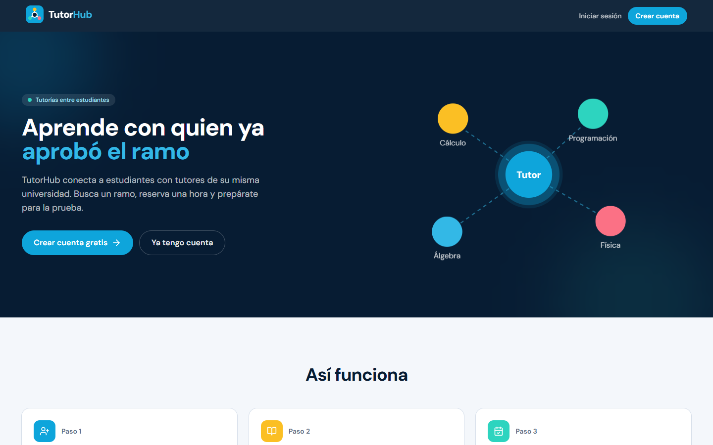
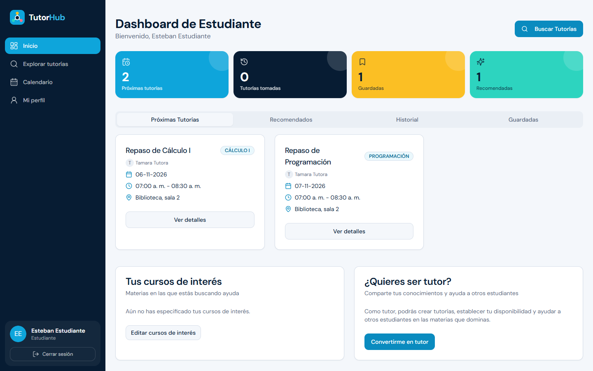
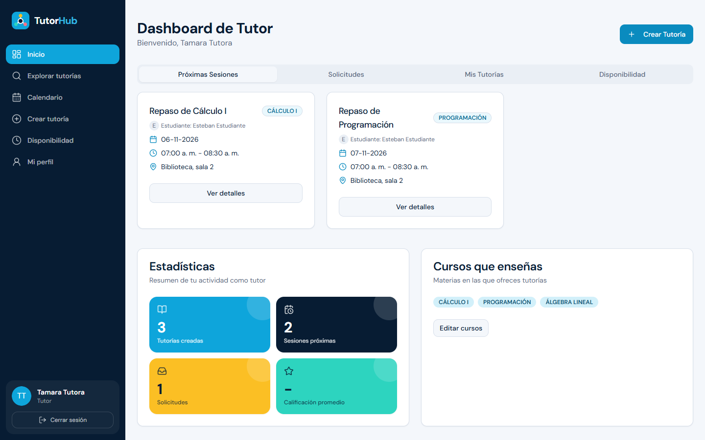
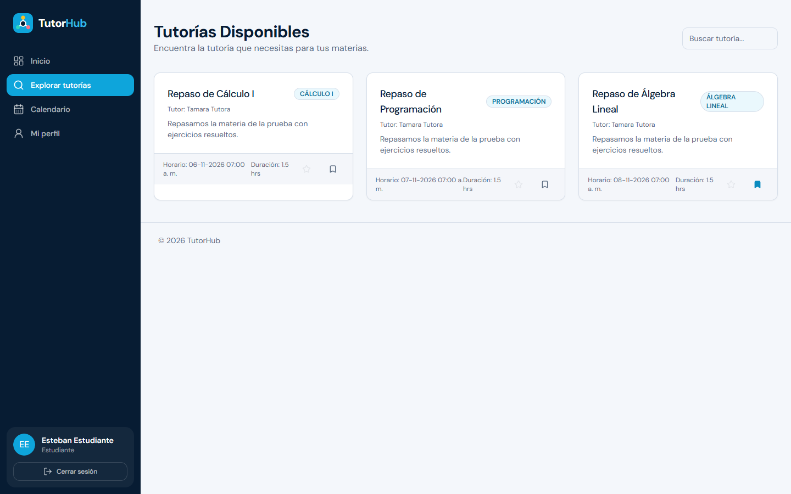
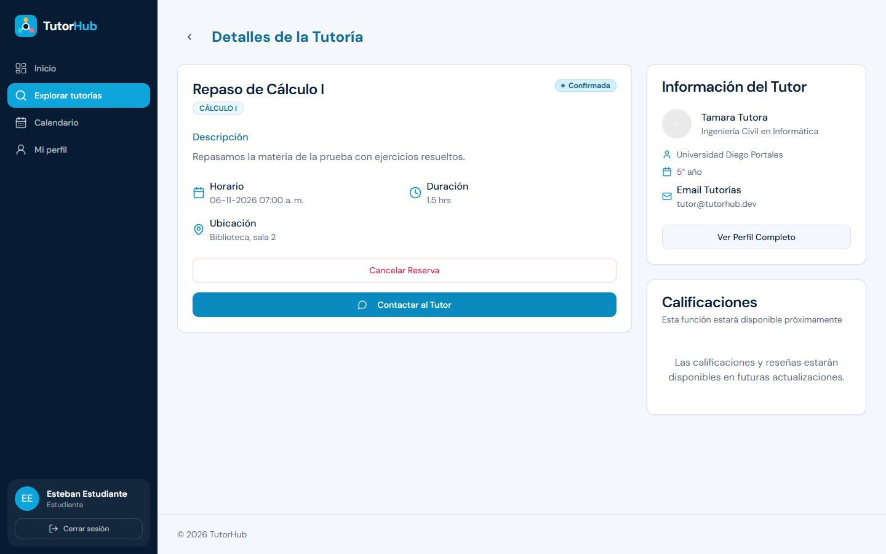
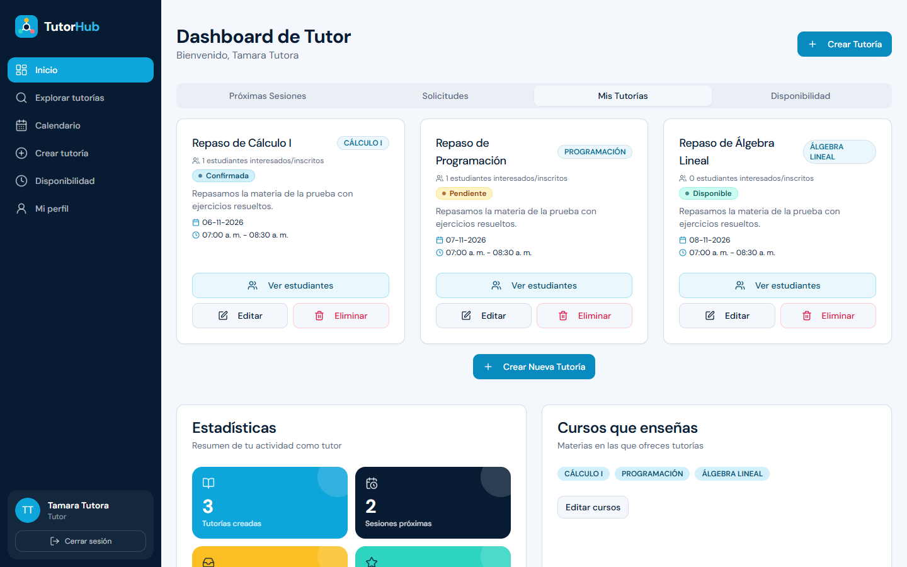
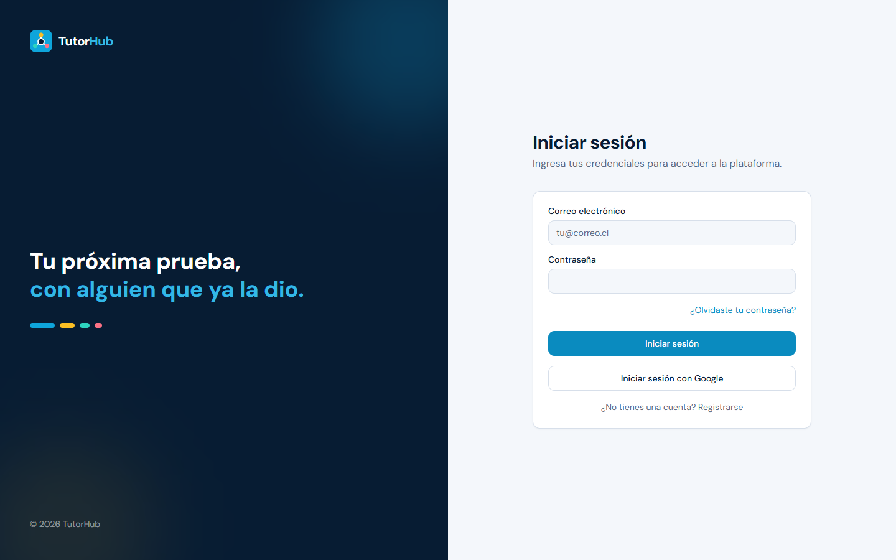
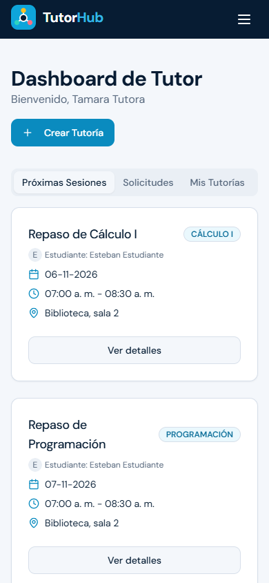
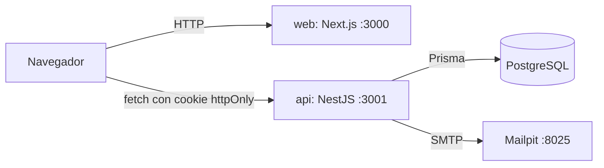

# TutorHub

[](https://github.com/DHat3r/TutorHub/actions/workflows/ci.yml)


> Plataforma que conecta a estudiantes universitarios con tutores: los tutores publican tutorías y su disponibilidad, y los estudiantes las buscan, reservan y califican.



## Capturas

| Dashboard del estudiante | Dashboard del tutor |
|:---:|:---:|
|  |  |
| **Explorar tutorías** | **Detalle de una tutoría** |
|  |  |
| **Mis tutorías (tutor)** | **Inicio de sesión** |
|  |  |

<p align="center">
  
  <br />
  <em>En el celular, la barra lateral se vuelve un menú desplegable.</em>
</p>

## Origen

TutorHub es la reestructuración de **LinkUDP**, un proyecto en equipo de 2025 para la Universidad Diego Portales ([repo original](https://github.com/DTC04/LinkUDP)). En ese proyecto participé en el backend y el frontend. Aquí lo rehice solo para dejarlo funcionando y en un solo repositorio:

| En LinkUDP | En TutorHub |
|------------|-------------|
| Dos repos (backend y frontend) que se levantaban por separado | Un repo y `docker compose up` |
| `dist/` versionado y sin `.env.example` | `.gitignore` desde el primer commit y `.env.example` completo |
| `assign-role` cambiaba el rol de cualquier usuario sin sesión | El usuario sale del JWT |
| Crear, editar y borrar tutorías y disponibilidad sin login; el `tutorId` venía en el body | Exigen sesión y verifican que el recurso sea del tutor |
| El token JWT se escribía en los logs | Sin logs de credenciales y `JWT_SECRET` obligatorio |
| El registro dependía de Gmail y la app no arrancaba sin credenciales de Google | SMTP configurable (Mailpit en desarrollo) y Google opcional |
| El build del frontend fallaba en `/verify` y ocultaba los errores de tipos | Compila con la revisión de tipos activada |
| 4 specs de plantilla que fallaban y uno que nunca corría (`.spect.ts`) | 19 tests unitarios y 7 e2e en CI |
| Colores `sky` de Tailwind escritos a mano en cada página y menú superior de texto | Paleta propia en un solo lugar, barra lateral según el rol, logo y landing nuevos |

## Stack

| Capa | Tecnología |
|------|------------|
| Backend | NestJS 11, Prisma 6, Passport JWT (cookie httpOnly), Swagger |
| Frontend | Next.js 15, React 18, Tailwind, shadcn/ui |
| Base de datos | PostgreSQL 16 |
| Correo | Nodemailer + Mailpit en desarrollo |
| Infraestructura | Docker Compose, GitHub Actions |

## Cómo ejecutarlo

```bash
git clone https://github.com/DHat3r/TutorHub.git
cd TutorHub
cp .env.example .env
docker compose up --build
```

| Servicio | URL |
|----------|-----|
| Frontend | http://localhost:3000 |
| API y Swagger | http://localhost:3001/api-docs |
| Correos (Mailpit) | http://localhost:8025 |

La API aplica las migraciones y el seed al arrancar. El seed crea los ramos y dos usuarios de demo ya verificados (contraseña `demo1234`, configurable con `SEED_DEMO_PASSWORD`):

- `tutor@tutorhub.dev`: tutor con tres tutorías publicadas.
- `estudiante@tutorhub.dev`: estudiante que puede reservarlas.

Si te registras con una cuenta nueva, el correo de verificación aparece en Mailpit.

## Tests

```bash
cd backend
npm ci
npm test            # unitarios, sin base de datos
npm run test:e2e    # e2e: necesita Postgres con migraciones y seed (docker compose up db)
```

## Arquitectura



- `backend/`: API REST por módulos (`auth`, `tutorias`, `bookings`, `availability`, `profile`, `courses`). Esquema y migraciones en `backend/prisma`.
- `frontend/`: App Router de Next.js. Llama a la API con `NEXT_PUBLIC_BACKEND_URL` y `credentials: 'include'`.

Flujo principal: el tutor publica una tutoría → el estudiante la reserva (queda `PENDING`) → el tutor la confirma (`CONFIRMED`) y el bloque de disponibilidad se recorta → después de la sesión, cada uno califica al otro.

## Decisiones técnicas

- **Carpetas `backend/` y `frontend/` sin workspaces:** las dos apps no comparten código, así que un gestor de workspaces solo agregaría configuración. Cada una tiene su `package-lock.json` y su Dockerfile.
- **La API toma al usuario del JWT, nunca del body:** es la corrección de fondo de los huecos de seguridad. El frontend todavía envía `tutorId`, pero el servidor lo ignora.
- **Mailpit en vez de Gmail:** permite probar el registro completo (verificación y recuperación de contraseña) sin credenciales reales.
- **Migraciones y seed al arrancar el contenedor:** el proyecto queda listo con un solo comando. El seed es idempotente, así que reiniciar no duplica datos.
- **Colores como tokens de diseño:** la paleta `brand` (azul marino y cian) está definida una sola vez en `tailwind.config.js`, y los componentes `StatusBadge` y `StatTile` concentran los colores de los estados y las estadísticas. Cambiar un tono se hace en un archivo, no en 230 clases.
- **Animaciones con CSS puro:** la ilustración de la landing late y fluye con `@keyframes`, sin librerías, y se apaga si el sistema pide reducir el movimiento (`prefers-reduced-motion`).

## Qué mejoraría con más tiempo

- Arreglar la configuración de ESLint del backend (mezcla ESLint 8 con configuración plana) y sumarlo al CI.
- Tests de `bookings` y `profile`, y tests del frontend.
- Despliegue público.
- Llevar el diseño nuevo a las páginas que todavía tienen la estructura original (perfil, crear y editar tutoría, calendario y disponibilidad).
- Las calificaciones de tutores aparecen como "próximamente" en la vista de detalle.

## Autor

Leandro · [GitHub](https://github.com/DHat3r)

Proyecto original LinkUDP: equipo DTC04 (2025).
